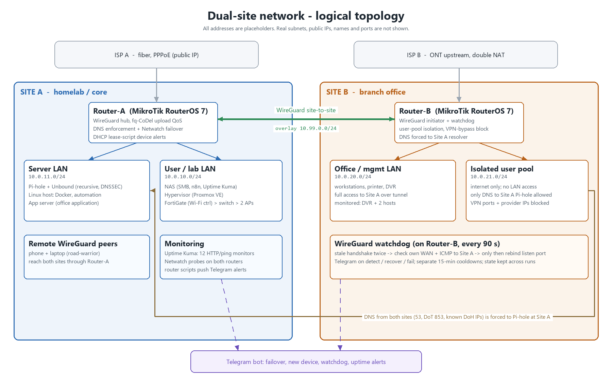

# Network Engineering Portfolio: Dual-Site MikroTik Network

I design, build and run a two-site network on MikroTik RouterOS 7: WireGuard between the sites,
DNS filtering that clients can't bypass, automatic failover, QoS, and Telegram alerting. Each case
below follows the same pattern: **the problem, what I built, the measured result, and the real
config** (sanitized).



**Sites:** Site A (core / homelab, this page) · [Site B: branch office](site-b/README.md), linked to Site A by WireGuard · [Site C: separate FortiGate network](site-c/README.md), 3 ISPs with SD-WAN (not connected to A/B)

> **Sanitized for publication.** Every address in this repo is a placeholder: `10.0.x.x` stands in
> for the real private subnets, `198.51.100.x` for public IPs, and `<PLACEHOLDER>` for keys, tokens,
> usernames, ports and MACs. Device and person names are generic. Inbound port forwards, ARP/DHCP
> tables and location settings have been removed entirely.

| Segment | Placeholder | Purpose |
|---|---|---|
| Site A server LAN | `10.0.11.0/24` | Pi-hole + Unbound resolver, Linux automation host, app server |
| Site A user/lab LAN | `10.0.10.0/24` | NAS, hypervisor, Wi-Fi (FortiGate controller + 2 FortiAPs behind a Ruckus ICX switch) |
| WireGuard overlay | `10.99.0.0/24` | site-to-site tunnel + road-warrior peers |
| Site B office LAN | `10.0.20.0/24` | office workstations, printer, DVR |
| Site B user pool | `10.0.21.0/24` | isolated, internet-only user segment |

*Note: the segments are separate L3 subnets on each router's bridge, not 802.1Q VLANs.*

---

## 1. Self-healing DNS: Pi-hole failover with Netwatch

**Problem.** All DNS for both sites goes to one Pi-hole. If that host or its resolver dies, every
client loses name resolution, and it looks like "the internet is down".

**What I built.** A RouterOS Netwatch probe sends a real DNS query (type `dns`, not ping) to the
Pi-hole every 15 s with a 3 s timeout. When it fails, a debounced script chain runs:
1. `pihole-down` schedules a one-shot confirmation for 30 s later, so a single lost probe can't flap DNS.
2. `confirm-pihole-down` re-checks. If the probe is still down, it points the router's resolvers and
   **both DNS-redirect NAT rules** at a public resolver, flushes the DNS cache, sends Wake-on-LAN to the
   Pi-hole host (in case it's asleep rather than crashed), and posts a Telegram alert.
3. The mirror pair (`pihole-up` → `confirm-pihole-up`) restores everything when the probe recovers.

The NAT rules are found by comment (`[find comment~"DNS-redirect-Pihole"]`), not by rule number.
The first version used `nat set 1,2`, and I rewrote it after an audit showed it would silently retarget
the wrong rules as soon as anyone reordered the NAT table.

**Result.** It fails over and recovers with no manual step, and it has fired repeatedly on real
Pi-hole outages.
The other site's router has its own simpler DNS-health Netwatch with the same public-resolver fallback.

```routeros
/tool netwatch
add type=dns host=fb.com dns-server=10.0.11.13 interval=15s timeout=3s startup-delay=10m \
    down-script="/system script run pihole-down" up-script="/system script run pihole-up"

# confirm-pihole-down (runs 30 s after the first failure)
:if ([/tool netwatch get [find host="fb.com"] status] = "down") do={
  /ip dns set servers=8.8.8.8
  /ip firewall nat set [find comment~"DNS-redirect-Pihole"] to-addresses=8.8.8.8
  /ip dns cache flush
  /tool wol mac=<MAC> interface=bridge
  /tool fetch url="https://api.telegram.org/bot<TELEGRAM_BOT_TOKEN>/sendMessage?chat_id=<TELEGRAM_CHAT_ID>&text=PiHole%20is%20Down" keep-result=no
}
```
Scripts: [`scripts/site-a/`](scripts/site-a/)

---

## 2. DNS enforcement: clients can't bypass the filter

**Problem.** A device with hard-coded `8.8.8.8`, DNS-over-TLS or DNS-over-HTTPS skips filtering entirely.

**What I built.**
- **Plain DNS:** dst-nat sends every TCP/UDP 53 query to the Pi-hole, except from a small allow-list of hosts (address-list `DNS`).
- **DoT:** TCP/UDP 853 is redirected to the Pi-hole as well, so DoT clients fail and fall back to plain DNS.
- **DoH:** TCP 443 to 12 well-known DoH resolver IPs (Cloudflare, Google, Quad9, AdGuard, NextDNS) is redirected the same way.
- **Resolver:** the Pi-hole forwards to a **local Unbound** instance doing full recursion with DNSSEC validation, so no single upstream provider sees all the queries.
- The other site's router uses the same redirect set, pointed across the tunnel.

**Result.** Filtering applies to every client, including ones that try to bypass it. The blocklist was
**~1.52 M unique domains** (2026-08-23, after adding an NSFW list).
**Incident I caught and fixed:** enabling DNSSEC in *both* Unbound and Pi-hole's dnsmasq layer made
dnsmasq re-validate answers Unbound had already validated. dnsmasq hit its validator resource limit on
`google.com` and returned SERVFAIL for every Google-hosted domain for about 21 h. My original test had
queried Unbound's port directly. The fix was to validate once (Unbound only). The lesson: **always test
DNS changes on the port clients actually use (53)**, not the backend port.

```routeros
/ip firewall nat
add action=dst-nat chain=dstnat comment=DNS-redirect-Pihole-UDP dst-port=53 protocol=udp \
    src-address-list=!DNS to-addresses=10.0.11.13 to-ports=53
add chain=dstnat comment="Redirect DoT UDP to Pi-hole" dst-port=853 protocol=udp to-addresses=10.0.11.13 to-ports=53
add chain=dstnat comment="Redirect DoH to Pi-hole" dst-address-list=DoH-Servers dst-port=443 \
    protocol=tcp to-addresses=10.0.11.13 to-ports=53
```

---

## 3. QoS: fq-CoDel upload shaping with a FastTrack-aware realtime class

**Problem.** Bulk uploads were adding latency to calls, remote desktop and gaming. The router (a
MikroTik hEX S-class box) can't push the line rate with FastTrack fully off, so classic
"shape everything" QoS wasn't an option.

**What I built.** A **hybrid design**:
- An upload queue tree shaped to **480 Mbit/s** with fq-CoDel leaves.
- A **realtime class**: STUN/VoIP/RTP and game UDP ports (3478-3480, 4380, 5060-5061, 10000-20000, 27000-27100),
  plus RDP/SSH, are connection-marked and **accepted before the FastTrack rule**. That keeps them on the
  slow path where the shaper can see them, and they go into a priority-1 leaf. Bulk traffic stays
  fast-tracked.
- The WireGuard tunnel gets its own priority-1 leaf (`fq-codel-wg`).
- DSCP marking: VoIP → EF (46), RDP → AF41 (34), SSH → AF21 (18), tunnel → CS5 (40).

**Result.** Measured 2026-10-06: game-server latency **62 ms idle → 80 ms max at ~480 Mbit/s upload**,
which is no significant bufferbloat on the upload side. I documented the limits:
the download tree is inert on this hardware, and full both-direction QoS would need a bigger router.
<!-- NOTE: game port range was widened to 27000-27200 on 2026-10-06; the export here (2026-08-30) still shows 27100. -->

```routeros
/queue type add kind=fq-codel name=fq_codel_up
/queue tree
add name=WAN-upload parent=global max-limit=480M packet-mark=no-mark
add name=realtime-up  parent=WAN-upload packet-mark=qos-rt    priority=1 limit-at=30M max-limit=480M queue=fq_codel_up
add name=WG-priority  parent=WAN-upload packet-mark=wg-tunnel priority=1 limit-at=50M max-limit=480M queue=fq-codel-wg
add name=bulk-traffic parent=WAN-upload packet-mark=no-mark              limit-at=50M max-limit=480M queue=fq_codel_up
/ip firewall mangle
add action=mark-connection chain=prerouting comment=QoS-noFT-UDP-realtime protocol=udp \
    dst-port=3478-3480,4380,5060,5061,10000-20000,27000-27100 new-connection-mark=qos-no-ft
add action=mark-packet chain=prerouting comment=QoS-rt-packet connection-mark=qos-no-ft new-packet-mark=qos-rt
/ip firewall filter
add action=accept chain=forward comment=QoS-noFT-accept-before-fasttrack connection-mark=qos-no-ft
```

---

## 4. New-device detection: DHCP lease alerts to Telegram

**Problem.** New devices on the LAN were only noticed by accident.

**What I built.** A RouterOS **`lease-script`** on the DHCP server, running on the router with no
external poller. On every real DHCP bind, if the lease has no comment (an unknown device), it looks up
the MAC vendor through a public API, **writes the vendor into the lease comment** so the device labels
itself from then on, and sends a Telegram alert with MAC, vendor and IP. Known devices are skipped and
cost nothing. Each external call is wrapped in `:do {} on-error={}` so a slow lookup can't stall DHCP.

**Result.** Live since 2026-08-17. It replaced an earlier cron poller on a Linux host. I measured the
worst-case lookup timeout at **~10 s**, and the `on-error` guard caps it there.
Tested against a real unlabeled device (comment written, Telegram API returned HTTP 200).

```routeros
/ip dhcp-server set defconf lease-script="/system script run vendor-tag-lease"
# vendor-tag-lease (excerpt)
:if ($leaseBound=1) do={
  :local lease [/ip dhcp-server lease find mac-address=$leaseActMAC]
  :if ([/ip dhcp-server lease get $lease comment] = "") do={
    :local vendor "unknown vendor"
    :do { :set vendor ([/tool fetch url="https://api.macvendors.com/$leaseActMAC" as-value output=user]->"data") } \
      on-error={ :set vendor "vendor lookup failed" }
    /ip dhcp-server lease set $lease comment=$vendor
    # ...Telegram POST, also wrapped in on-error
  }
}
```
Full script: [`scripts/site-a/vendor-tag-lease.rsc`](scripts/site-a/vendor-tag-lease.rsc)

---

## 5. Monitoring and alerting

**Problem.** There are about a dozen self-hosted services across several machines, and nobody
watches dashboards.

**What I built.**
- **Uptime Kuma** (Docker on the NAS) with **12 monitors**: HTTP checks (automation, NAS, hypervisor,
  resolver UI, reverse proxy, AI services) and 4 ping, as configured in 2026-06. Telegram is the default
  notification channel for down and recovery events.
- **Router-side Netwatch chains** with the same debounce pattern as case 1: the site-to-site
  tunnel (ping the remote router across WireGuard) and the office app server, each with up/down Telegram messages.
- **Wazuh SIEM (homelab, being rebuilt on a new host):** the router is set up to forward info/warning/error/critical/firewall log topics via remote syslog.

**Real bug found by this work:** the tunnel up/down alerts had silently never fired. The confirm scripts
looked up a Netwatch entry by a host name that only existed on the *other* router (a copy-paste
leftover), so `find` returned nothing and the script died before sending the alert. I fixed it and
verified (HTTP 200 from Telegram).
**Rule I took from it:** the `[find host=...]` in a confirm script must match its Netwatch entry exactly.

---

## 6. Automated config backups

**What I built.** A RouterOS script runs `/export` (readable `.rsc`) plus `/system backup save`
(binary). It waits in a loop (up to 15 s) until the backup file exists, then emails both files.
It runs on a scheduler on **both** routers (scheduled runs, not daily).

**Result.** Off-box copies of both formats, with no manual export.

```routeros
/export file=$textfilename
/system backup save name=$backupfilename
:local timeout 0
:while ([/file find name=$backupfilename] = "" && $timeout < 15) do={ :delay 1s; :set timeout ($timeout + 1) }
# ...then /tool e-mail send with both files attached
```

---

## 7. Router hardening (baseline)

- Input-chain **brute-force ladder**: 6 one-minute stages, then a 1-day blacklist for new connections from outside the management list.
- FTP, Telnet, HTTP and API services disabled; WebFig over HTTPS on a non-default port; MAC-Winbox and neighbor discovery limited to the LAN list.
- Bridge `arp=reply-only` with static ARP, so unknown hosts get no gateway.
- RouterOS default IPv6 firewall kept (bogon lists, RFC 4890 ICMPv6 handling).

---

## Lessons and runbooks (from real incidents)

- RouterOS `place-before` on `add` didn't reliably land rules at the requested position on this build, which left new rules inert behind FastTrack. Now I **add, verify the position, then `move`**.
- NAT and filter packet counters stay at 0 for fast-tracked flows. To prove a rule works I use packet capture (`/tool torch`) or the service's own logs.
- I verify DNS changes through port 53, the path clients actually use (see case 2).

---

## Repository layout

```
README.md                         this file
diagrams/topology.png             logical topology (placeholders only)
configs/site-a-router.rsc         full sanitized export, Site A core router
scripts/site-a/                   every /system script from Site A, one file each
site-b/                           Site B (branch office): case studies 8-11, config, scripts
site-c/                           Site C (separate FortiGate network): SD-WAN across 3 ISPs, config excerpt
```

**Stack:** MikroTik RouterOS 7 · WireGuard · Pi-hole · Unbound (DNSSEC) · fq-CoDel · Netwatch ·
RouterOS scripting · Telegram Bot API · Uptime Kuma · Docker · TrueNAS · Proxmox VE · FortiGate / FortiAP · Ruckus ICX
